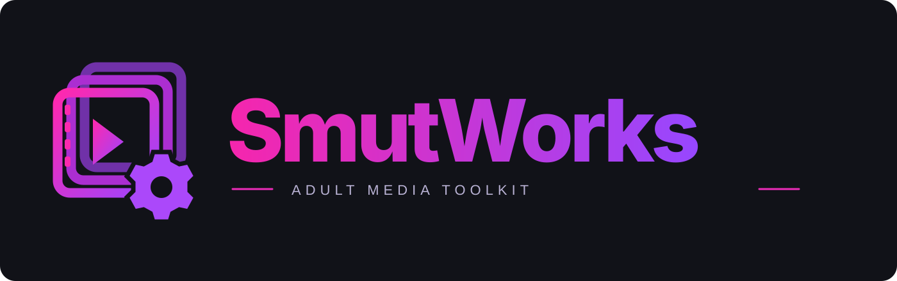

<div align="center">



**Less sorting. Less clutter. More space.**

A terminal toolkit for organizing, maintaining, and encoding your adult media library.

[](https://github.com/thef4tdaddy/SmutWorks/tree/develop)
[](#getting-started)
[](#getting-started)
[](LICENSE)

[**Try the alpha →**](https://github.com/thef4tdaddy/SmutWorks/tree/develop) · [Feature guide](https://github.com/thef4tdaddy/SmutWorks/blob/develop/docs/legacy-guide.txt) · [Report a bug](https://github.com/thef4tdaddy/SmutWorks/issues/new?template=bug_report.yml) · [Suggest a feature](https://github.com/thef4tdaddy/SmutWorks/issues/new?template=feature_request.yml)

</div>

---

## Your library, with the chores handled

SmutWorks connects to **Stash** to turn existing metadata into practical organization and maintenance tools. Preview moves, find scenes that need attention, clean up leftover folders, and build **HandBrakeCLI** encoding queues—all from an arrow-key terminal interface.

It also supports retrying **Whisparr Sync** for one selected StashDB-linked scene.

> **Currently in alpha.** The application lives on [`develop`](https://github.com/thef4tdaddy/SmutWorks/tree/develop). This branch is the project landing page; a stable release has not been published yet.

## What it does

| Tool | What you get |
| --- | --- |
| **Organize scenes** | Preview incoming-file moves using Stash titles and performers matching configurable gender preferences. |
| **Find missing metadata** | Flag scenes needing titles or performer information while keeping your other tags. |
| **Clean up leftovers** | Review empty directories, leftover images, and small files in incoming and organized folders. |
| **Review duplicates** | Find attached-file, perceptual-hash, fingerprint, Stash-ID, URL, and title matches; compare copies and recommend keepers. |
| **Clean up reviewed copies** | Consolidate compatible metadata, set a primary file, and separately quarantine, restore, or delete a recorded non-primary copy. |
| **Set preferred quality** | Share one quality standard across encoding, discovery, and duplicate recommendations, with optional minimum savings cutoffs. |
| **Build smarter encoding queues** | Use Stash metadata or cached file scans and prioritize the largest estimated GiB saved. |
| **Follow every encode** | Keep the current filename, queue position, progress, speed, ETA, and stage above the scrolling log. |
| **Review the results** | Inspect completed encodes and optionally make a reviewed output primary in Stash. |
| **Keep a history** | Review recorded moves and completed encodes, with guarded undo for supported actions. |

### Encoding with a purpose

The default target is **1080p H.265 10-bit at 5,000 kbps**, with editable settings and output beside the source as `filename - reencoded.mkv`.

Queues run sequentially and put the biggest estimated reductions first. CSV reports show the estimated output size, savings in GiB, and percentage reduction. Estimates include an audio allowance; actual results depend on the source and encoder.

**Originals are kept.** Encoding creates another file; disk space is only reclaimed if you later remove or replace a source after reviewing the result. HDR sources are held for separate review.

### Preview first, apply when ready

Organization and cleanup provide reports before separate apply actions. Image collection keeps the images in a `leftover images/` folder under the relevant root. Duplicate comparisons do not automatically delete videos.

## Getting started

You will need **macOS**, **Python 3.8+**, a running **Stash** instance, and access to your media files. Encoding and output review also require **HandBrakeCLI** and **ffprobe**.

With Homebrew installed:

```sh
brew install python handbrake ffmpeg
git clone -b develop https://github.com/thef4tdaddy/SmutWorks.git
cd SmutWorks
python3 smutworks.py
```

Or [download the alpha source ZIP](https://github.com/thef4tdaddy/SmutWorks/archive/refs/heads/develop.zip), extract it, and run `python3 smutworks.py` from its folder.

1. Open **Connection and folder settings** and enter your Stash URL, API key, and media paths.
2. Run **Test connection and folders**.
3. Start with a preview or read-only report.

Navigate six sections: **Organize · Metadata · Duplicates · Encoding · Cleanup · Settings & History**. Use **↑ / ↓** and **Enter** to open items; **Esc / ←** goes back. Numbers are local to each submenu. **PgUp / PgDn** scroll the task output while encoding status stays pinned above it.

See the [menu guide](https://github.com/thef4tdaddy/SmutWorks/blob/develop/docs/navigation.md) and [duplicate review workflow](https://github.com/thef4tdaddy/SmutWorks/blob/develop/docs/duplicates.md). Recommendations never automatically delete media; file actions recheck current state and require confirmation.

See the [alpha setup guide](https://github.com/thef4tdaddy/SmutWorks/blob/develop/README.md) for path mapping, settings, reports, and upgrades. Configure the local media root and the equivalent path seen by Stash; fixed Docker mount names are not required.

## A few things to know

- NAS shares must remain connected during scans and encodes. The current runner reads and writes directly on the share.
- A failed encode or verification retains a hidden `.aco-partial-*.mkv` output for inspection. Automatic recovery is not implemented yet.
- The Mac must stay awake while jobs run. Remote monitoring and local encoding staging are planned, not current features.
- Settings and API keys stay in the application's private local settings directory. Reports and history stay in its local `reports/` folder.
- Existing installations retain their earlier settings location and `ACO -` managed tags for compatibility.

## Project status & contributing

**Current alpha: `0.1.0-alpha.3`.** Active code and testing are on `develop`; `main` is reserved for stable release code and project information.

Have an idea or found something broken? [Open an issue](https://github.com/thef4tdaddy/SmutWorks/issues). Read [CONTRIBUTING.md](CONTRIBUTING.md) before sending a change, and [SECURITY.md](SECURITY.md) before sharing logs or reporting a sensitive problem.

The alpha includes automated tests for organization, cleanup, queue ranking, encoding safeguards, and terminal status handling. See the [changelog](https://github.com/thef4tdaddy/SmutWorks/blob/develop/CHANGELOG.md) for current changes.

## License

SmutWorks is licensed under [GPL-3.0](LICENSE). Stash, Whisparr, HandBrake, and FFmpeg are separate projects; SmutWorks is not affiliated with their maintainers.
